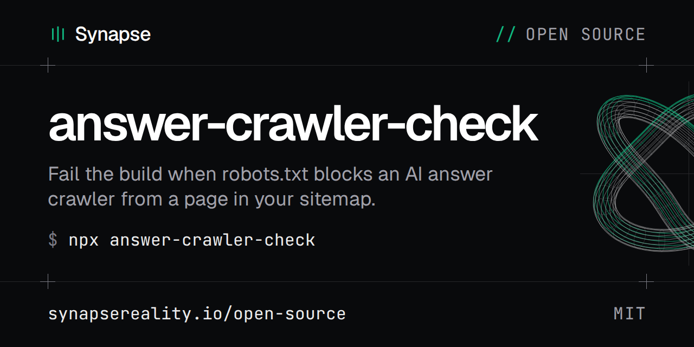

[](https://synapsereality.io/open-source/answer-crawler-check/)

[](https://www.npmjs.com/package/answer-crawler-check)
[](https://github.com/synapsereality/answer-crawler-check/actions/workflows/ci.yml)
[](https://github.com/synapsereality/answer-crawler-check/blob/main/LICENSE)

[Docs](https://synapsereality.io/open-source/answer-crawler-check/) |
[synapsereality.io](https://synapsereality.io) |
[Synapse open source](https://synapsereality.io/open-source/) |
[npm](https://www.npmjs.com/package/answer-crawler-check)

# answer-crawler-check

Fails your CI job when robots.txt blocks an AI answer crawler from any page in
your sitemap. OAI-SearchBot, Claude-SearchBot, PerplexityBot and the rest each
read their own `User-agent` group. One wrong line and that engine stops citing
the page, and nothing else in the build notices.

Docs: https://synapsereality.io/open-source/answer-crawler-check/

```bash
npx answer-crawler-check https://example.com/sitemap-index.xml
```

## What it checks

Every URL in the sitemap, against every chosen crawler, with the robots.txt of
that URL's site. Sitemap indexes and gzipped sitemaps are followed.

```text
$ answer-crawler-check dist/sitemap.xml --site-dir dist
https://example.com: robots.txt from dist/robots.txt, local file, 3 page(s)
ok      OAI-SearchBot  (no group of its own, uses *)
ok      ChatGPT-User  (no group of its own, uses *)
BLOCKED Claude-SearchBot  1 URL(s)
          https://example.com/docs/setup/  Disallow: /docs/ (line 9)
BLOCKED Claude-User  1 URL(s)
          https://example.com/docs/setup/  Disallow: /docs/ (line 9)
ok      PerplexityBot  (no group of its own, uses *)
...
answer-crawler-check: FAILED, 2 problem(s)
  Claude-SearchBot: blocked from 1 of 3 URL(s)
  Claude-User: blocked from 1 of 3 URL(s)
```

Each blocked URL comes with the rule that blocked it and its line number. The
exit code is 0 when everything is allowed, 1 when something is blocked, and 2
for a bad command line. [Exit codes](#exit-codes) has the details.

Single-URL checkers look at `/` or one page you paste in. That misses a
`Disallow: /docs/` in a group you forgot about, and a wildcard rule such as
`/*.html` that hits only some pages. This tool reads every page in the sitemap.

## Which crawlers

`--agents answer` is the default. It holds the crawlers that fetch pages while an
answer is written, or that build the index those answers cite:

| crawler | what it feeds |
|---|---|
| OAI-SearchBot | ChatGPT search |
| ChatGPT-User | ChatGPT fetching a page for a user |
| Claude-SearchBot | Claude's search index |
| Claude-User | Claude fetching a page for a user |
| PerplexityBot | Perplexity's index |
| Perplexity-User | Perplexity fetching a page for a user |
| DuckAssistBot | DuckDuckGo's AI answers |
| MistralAI-User | Le Chat fetching a page for a user |
| Applebot | Siri, Spotlight and Safari suggestions |
| Googlebot | Google Search, AI Overviews and AI Mode |
| Bingbot | Bing, and Copilot answers |

Training crawlers such as GPTBot, ClaudeBot, Google-Extended and CCBot are left
out on purpose. Blocking them is a reasonable choice and doesn't remove you from
search answers. Add them by name if you want them checked: `--agents answer,GPTBot`.

`--agents answer-extended` adds every crawler that ai.robots.txt files under "AI
Search Crawlers" or "AI Assistants", 43 names in the bundled copy.
`--agents all` checks all 179. `--list-agents` prints what a setting expands to.

## The crawler list

Crawler names and descriptions come from
[ai-robots-txt/ai.robots.txt](https://github.com/ai-robots-txt/ai.robots.txt), the
community list of AI crawlers (MIT). A copy of its `robots.json` ships in
`data/`, with the commit it came from in `data/UPSTREAM.md`. `--list latest`
fetches the current upstream file instead, and `--list path.json` reads your own
file in the same format.

That project keeps the list. If a crawler is missing, send the fix there.

## How robots.txt is read

The rules follow [RFC 9309](https://www.rfc-editor.org/rfc/rfc9309), the Robots
Exclusion Protocol, which is also what Google documents.

A crawler obeys the group that names it. Only when no group names it does it
fall back to `User-agent: *`, and a named group never inherits the `*` rules.
Inside a group the longest matching pattern wins and `Allow` wins a tie. `*` and
`$` work as wildcards and end anchors. Groups that name the same crawler twice
are merged.

A robots.txt that answers 404 (or any 4xx apart from 429) means no rules, so
everything is allowed. A 5xx, a 429 or no answer at all means "disallow
everything" to a crawler. The tool then reports every page on that site as
blocked.

`--require-named` also fails any crawler that has no group of its own. Use it if
your policy is to allow answer crawlers by name.

## Options

| flag | |
|---|---|
| `--agents SPEC` | `answer` (default), `answer-extended`, `all`, or names `A,B,C` |
| `--robots FILE\|URL` | use this robots.txt for every site instead of fetching it |
| `--site-dir DIR` | read sitemaps and robots.txt from a local build when the file is there |
| `--url URL` | also check this page, repeatable |
| `--require-named` | fail crawlers that only fall through to `*` |
| `--list FILE\|URL\|latest` | crawler list in `robots.json` format |
| `--max-urls N` | stop after N page URLs (default 50000) |
| `--json FILE` | full report as JSON, `-` for stdout |
| `--report-only` | print the report, always exit 0 |

## Before you deploy

With `--site-dir`, a sitemap URL such as `https://example.com/sitemap-0.xml` is
read from `dist/sitemap-0.xml` when that file exists, and `dist/robots.txt` is
used for every page. The build is checked before it goes live, with no network
calls for your own files.

```bash
npm run build
answer-crawler-check dist/sitemap-index.xml --site-dir dist
```

## Run it in CI

Each job below fails when a crawler is blocked. The jobs that check a build
assume `npm run build` writes the site to `dist/`. Change the paths to match
your build.

### GitHub Actions

```yaml
- uses: actions/checkout@v4
- run: npm ci && npm run build
- uses: synapsereality/answer-crawler-check@v0.1.1
  with:
    sitemap: dist/sitemap-index.xml
    site-dir: dist
```

Or against the live site, on a schedule:

```yaml
on:
  schedule:
    - cron: "0 6 * * 1"
jobs:
  crawlers:
    runs-on: ubuntu-latest
    steps:
      - uses: synapsereality/answer-crawler-check@v0.1.1
        with:
          sitemap: https://example.com/sitemap-index.xml
          require-named: "true"
```

The action runs on the runner's own Node (20 or later) and installs nothing.

### GitLab CI

In `.gitlab-ci.yml`, check the build on every pipeline:

```yaml
answer-crawlers:
  image: node:22-slim
  script:
    - npm ci
    - npm run build
    - npx --yes answer-crawler-check@0.1.1 dist/sitemap-index.xml --site-dir dist --json crawlers.json
  artifacts:
    when: always
    paths:
      - crawlers.json
```

`when: always` keeps the JSON report when the job fails, which is when you
need it. To check the live site instead, add a job that runs only in
scheduled pipelines, and create the schedule under Build > Pipeline
schedules:

```yaml
answer-crawlers-live:
  image: node:22-slim
  rules:
    - if: $CI_PIPELINE_SOURCE == "schedule"
  script:
    - npx --yes answer-crawler-check@0.1.1 https://example.com/sitemap-index.xml --require-named
```

### Bitbucket Pipelines

In `bitbucket-pipelines.yml`:

```yaml
image: node:22-slim

pipelines:
  default:
    - step:
        name: Check AI answer crawler access
        script:
          - npm ci
          - npm run build
          - npx --yes answer-crawler-check@0.1.1 dist/sitemap-index.xml --site-dir dist
  custom:
    answer-crawlers-live:
      - step:
          name: Check the live site
          script:
            - npx --yes answer-crawler-check@0.1.1 https://example.com/sitemap-index.xml --require-named
```

A custom pipeline only runs when you start it or schedule it. To run
`answer-crawlers-live` every week, go to Pipelines, then Schedules, and pick it
there.

### Any other CI: a shell step

Jenkins, CircleCI, Drone, a Makefile or a git hook: anything that runs a shell
command and reads its exit code. You need Node 20 or later.

```bash
npm run build
npx --yes answer-crawler-check@0.1.1 dist/sitemap-index.xml --site-dir dist
```

To tell a blocked crawler apart from a check that couldn't run:

```bash
status=0
npx --yes answer-crawler-check@0.1.1 dist/sitemap-index.xml --site-dir dist || status=$?
case $status in
  0) echo "every answer crawler can reach every page" ;;
  1) echo "a crawler is blocked, or the check hit a problem. See the output above."; exit 1 ;;
  *) echo "answer-crawler-check did not run: check the command line"; exit 2 ;;
esac
```

### Exit codes

| code | meaning |
|---|---|
| 0 | Every chosen crawler can fetch every URL. With `--report-only`, any check that ran gives 0. |
| 1 | At least one problem, and the report lists each one. A crawler is blocked from a URL, or has no group of its own under `--require-named`. A sitemap or the `--robots` file couldn't be read, a robots.txt was over 512 KiB, or there were no URLs to check. A crash also gives 1, for example a `--json` path that can't be written. |
| 2 | The command line was wrong: an unknown flag, no sitemap or `--url`, a bad `--max-urls`, or a `--list` file that couldn't be read. Nothing was checked. |

`npx --yes` installs the package without asking. Pin the version, as above, so
a new release can't change a passing build. With the package in your
`devDependencies`, `npx answer-crawler-check` uses that copy instead.

## Install from source

```bash
git clone https://github.com/synapsereality/answer-crawler-check
cd answer-crawler-check
node bin/answer-crawler-check.js --help
```

No dependencies. Node 20 or later.

## Tests

```bash
npm test
```

33 tests: the robots.txt rules above, sitemap indexes and gzip, the 4xx and 5xx
cases, `--site-dir`, and the CLI exit codes. They use a local HTTP server.

## What it doesn't check

robots.txt is only one door. A crawler can still be turned away by a firewall
rule, a bot-protection challenge, a `noindex` tag or an `X-Robots-Tag` header.
This tool reads robots.txt and nothing else.

## Licence

MIT. The bundled crawler list is MIT too, copyright ai.robots.txt, see
`NOTICE.md`. Made by [Synapse](https://synapsereality.io/open-source/answer-crawler-check/).
